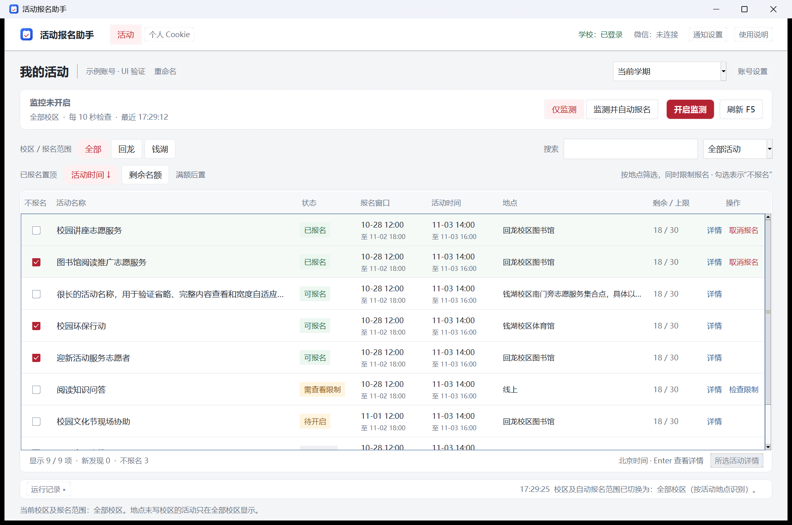

# 活动报名助手

Windows 桌面工具，用于浙江万里学院智慧思政活动页的个人活动查看、持续监测、自动报名及微信成功通知。支持回龙、钱湖校区，账号登录态仅加密保存在本机。

登录入口：[学校网上办事大厅](https://ehallapp.zwu.edu.cn:8080/)。登录后进入[智慧思政活动报名](https://nxg.zwu.edu.cn/zhxg/#/lifePractice/signup/list)；活动列表与 API 仍使用 `nxg.zwu.edu.cn`。本项目独立于 QQ/WPS 群活动助手，与学校或微信无隶属关系。



*截图来自实际桌面界面，账号、活动和运行状态均为示例。*

## 安装与启动

已验证环境：Windows x64、Python 3.13、Microsoft Edge。项目使用 `uv.lock` 固定依赖。

1. 安装 [Python 3.13](https://www.python.org/downloads/) 和 [uv](https://docs.astral.sh/uv/getting-started/installation/)，确认 Microsoft Edge 可以正常启动。
2. 下载并解压源码包，或克隆仓库。在源码根目录执行：

```powershell
uv sync --locked
uv run --locked python -m activity_check
```

之后可双击 `启动助手.cmd`；它会在缺少虚拟环境时运行 `uv sync --locked`，再启动桌面窗口。使用系统 Edge，不需要另外执行 `playwright install`。源码包不包含 Python、虚拟环境或免安装 EXE。

## 保存个人账号

首页点击“添加账号”，选择一种登录方式：

- **粘贴导入**：先登录学校网上办事大厅，再打开“智慧思政活动报名”，确认页面显示活动列表。在该活动页面打开 F12 → Console，运行助手通过“复制登录数据命令 / 查看步骤”提供的命令，把剪贴板中的完整登录数据粘贴回助手，再点“保存并检查登录”。命令在浏览器本机复制当前网站的数据。
- **网页登录**：在助手打开的独立 Edge 窗口中登录网上办事大厅，再进入“智慧思政活动报名”，直到显示活动列表。助手核验活动系统账号后保存登录态；若学校要求微信内认证，可使用正常登录渠道，再导入完整登录数据。

该网站还使用 `localStorage.token` 和 `teaInfo.id`；纯 Cookie 往往不够。完整登录数据无需另外填写 Token。仅有 Cookie 时，可展开补充项；个人标识通常不同于学号。不同学生需要分别新增账号，名称旁可重命名。

门户首页的登录数据不能替代活动系统的登录数据。`copy(...)` 在控制台返回 `undefined` 是正常的，内容已进入剪贴板；请回助手粘贴。只有门户登录成功、尚未进入活动列表时，助手不会显示已登录。

## 监测与报名

1. 进入账号，选择学期及“全部 / 回龙 / 钱湖”。校区按活动地点识别，**同时限制自动报名范围**；地点未注明校区的活动仅在“全部”范围检查。
2. 选择“仅监测”并点“开启监测”，或选择“监测并自动报名”并点“开启自动报名”。选择模式本身不会启动。切换模式或学期会先暂停。
3. 默认每 10 秒检查，可在“账号设置”中修改为 5–3600 秒。暂停按钮、运行状态、学校登录和微信连接分别显示。

自动模式从首次检查开始处理当前范围的**现有及新增**活动；报名已开放且确认有名额时尝试提交，尚未开放或满额的继续等待。仅监测模式首次建立基准，之后对新增活动显示“新”标记并提示。

复选框表示 **“不报名”**：勾选后排除自动报名，不需要先勾选才能报名。此标记按账号保存，刷新、切换模式和重新打开后保留。已报名不会因勾选而退出；需点击活动行的“取消报名”并确认。取消后同样保留“不报名”标记，防止再次报名。

提交前会重新核对报名窗口、名额、校区、排除标记及学校限制。已成功的请求不重复发送；结果不明记为待确认，需到官网核对。取消结果不明时同样不会盲目重发。需查看限制的活动可通过行内操作或右键重新检查。

## 列表与界面

- 尚未结束的已报名、报名成功活动置顶；可报名随后，满额排在其余未报名之后，已结束在后。活动结束按活动 `endTime` 判断，缺失结束时间时不推断；结果待确认与取消记录仍保留原状态。
- “活动时间”和“剩余名额”可同时排序，各自按降序、升序、关闭循环；同时开启时名额优先、时间打破平局。未知名额保持未知，明确不限名额单独显示。
- 搜索名称或地点，支持状态与学期筛选。活动时间、报名窗口分列并统一按北京时间显示；时间和地点由详情接口补齐，待加载与网站确实缺失分别说明。
- 刷新和 F5 保留输入、筛选、选中行和滚动位置。账号页切换还保留当前排序、未保存间隔输入和日志展开状态。
- 后台详情更新合并显示，最多每秒更新一次，避免密集重建页面；用户点击、搜索和筛选立即响应。
- 方向键选择活动，空格切换“不报名”，Enter 或双击查看详情，右键提供可用操作；长名称和地点可悬停查看全文。运行记录默认收起。

最小化后继续运行；关闭程序、电脑休眠或关机后停止。重新打开后需再次主动开启当前模式。报名成功表示学校接口接受报名，实际参加要求以活动方说明为准。

已有助手运行时，再次双击启动会恢复该数据目录对应的窗口，不会另开一份。使用 `--data-dir` 的隔离实例各自独立。

## 微信成功通知

顶部打开“通知设置” → “连接 / 重新授权”，用手机微信扫描二维码并确认文件传输助手网页版授权。成功报名后，通过 HTTPS 后台接口向自己的文件传输助手发送：

```text
已报名---活动名称
```

发送不操作电脑微信界面，不依赖电脑微信保持打开。会话失效时重新扫码；通知单独排队，不阻塞报名，也不会因通知失败重复报名。只通知新确认的成功记录，不补发历史报名或已取消活动；发送结果不明时不盲目重发。

## 本机数据

默认数据目录为 `%LOCALAPPDATA%\NXGActivityCheck`：

| 内容 | 用途 |
| --- | --- |
| `activities.db` | 账号备注、活动、排除标记、报名/取消结果及通知队列 |
| `sessions`、`pending-sessions` | 当前 Windows 用户 DPAPI 加密的学校登录态 |
| `wechat-web` | DPAPI 加密的文件传输助手网页版会话 |

这些数据不属于源码，不随发布包分发，也不应放入 Git 或问题报告。DPAPI 会话不适合跨 Windows 用户迁移。

## 开发与验证

```powershell
uv sync --locked
uv run --locked ruff check activity_check tests tools
uv run --locked ruff format --check activity_check tests tools
uv run --locked python -m compileall -q activity_check
uv run --locked python -m pytest -q
```

测试使用临时数据库、示例账号和本机 HTTP 服务，不会向真实学校接口提交。隔离运行桌面程序可指定独立目录：

```powershell
uv run --locked python -m activity_check --data-dir work\demo-data
```

Windows CI 运行锁定依赖、检查和测试；版本标签通过检查后生成源码 ZIP、清单及 SHA-256。见 [贡献说明](CONTRIBUTING.md)、[发布说明](docs/PUBLISHING.md)、[更新记录](CHANGELOG.md) 和 [安全报告](SECURITY.md)。

## 许可证

Copyright (C) 2026 QGYB and contributors。

本项目使用 **GNU Affero General Public License v3.0 only（`AGPL-3.0-only`）**，全文见 [LICENSE](LICENSE)。原始代码、文档和原创界面资源按此许可证发布；第三方组件保留各自条款，见 [第三方许可说明](THIRD_PARTY_NOTICES.md)。
